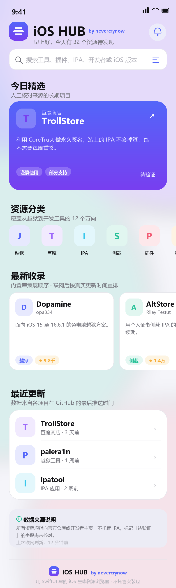

# iOS HUB

> 全生态 iOS 资源中心 · 双端原生 App（iOS + Android）
> 把越狱、巨魔、侧载、插件、软件源、开源项目、漏洞研究、开发工具、美化与资讯**收在一个 App 里**。

- iOS 版：iOS 17.0+（iPhone / iPad），Xcode 16+，Swift · SwiftUI · SwiftData
- 安卓版：Android 8.0+（API 26），Kotlin · Jetpack Compose
- 依赖：**零第三方依赖**（两端都只用官方框架）



> 按设计规范绘制的静态稿（`tools/render_mockup.py`），不是运行截图。

**品牌与动效预览：** [App 图标 1024](docs/app-icon-1024.png) · [冷启动动画 5 帧](docs/mockup-launch-frames.png) · [启动画面](docs/mockup-splash.png) · [详情页 README 卡片](docs/mockup-readme.png)

**视觉风格：液态玻璃（Liquid Glass）。** 页面底铺四团高斯模糊品牌光斑，卡片是白 86%→52% 渐变的半透明玻璃（18dp 彩色投影 + 1dp 渐变高光描边），顶栏磨砂、底部导航是悬浮玻璃胶囊；冷启动动画结尾留一行献词「献给 赵菁然」。

**📱 零基础装到手机上：**
- 安卓：**已编译好的安装包在 [`dist/iOSHub-1.0-release.apk`](dist/iOSHub-1.0-release.apk)（6.4 MB，直接装）**；想从源码自己打包看 [docs/ANDROID.md](docs/ANDROID.md)，**不需要账号、不需要证书、不过期**
- iPhone：[docs/PACKAGING.md](docs/PACKAGING.md) — 需要 GitHub 账号，约 30–45 分钟，无需 Mac
- **打不开资源链接？** 这是 `github.com` 被干扰，不是资源没了 → 看 [docs/LINKS.md](docs/LINKS.md)，App 里「我的 → 网络线路」可一键换镜像

## 两个平台，两套原生实现

| | iOS 版 | 安卓版 |
| --- | --- | --- |
| 代码位置 | `iOSHUB/` + `iOSHUB.xcodeproj` | `android/` |
| 技术 | Swift · SwiftUI · SwiftData | Kotlin · Jetpack Compose |
| 构建环境 | 必须 macOS（CI 或借 Mac） | Windows 本机即可（JDK+Gradle+SDK，已跑通） |
| 编译状态 | 静态检查通过（无 Mac 无法编译） | ✅ **真实编译通过，已产出签名 APK** |
| 安装 | Apple ID 签名，免费证书 7 天续签 | 直接装 APK，不过期 |
| 数据 | 共用同一份 `seed-resources.json`（41 条） | 同一份文件，放 assets |
| 镜像线路 | `LinkRouter.swift`（自动/直连/镜像/自定义） | `LinkRouter.kt`（同上，含测速界面） |

> SwiftUI 不能编译成 APK（iOS / Android 是两套完全不同的运行时），所以安卓版是**独立重写**的第二实现，不是转换产物。

---

## 一、先说结论：Windows 上怎么把它跑起来

这个工程是**完整的 Xcode 工程**，但 Swift/SwiftUI 必须在 macOS 上编译。你有三条路，按推荐顺序：

### 路线 A：白嫖一台 Mac（最省事，推荐）

1. 任意 Mac（朋友/公司/学校），装 **Xcode 16 或更新**（App Store 免费）。
2. 把整个文件夹拷过去，双击 `iOSHUB.xcodeproj`。
3. 选中 `iOSHUB` target → Signing & Capabilities → Team 选你的 Apple ID（Personal Team 即可）。
4. 顶部选你的 iPhone（或任意 iPhone 模拟器）→ 按 `⌘R`。
5. 真机首次运行需要在 iPhone「设置 → 通用 → VPN与设备管理」里信任你的开发者证书。

零成本，7 天证书到期后重新 `⌘R` 即可（免费账号限制）。

### 路线 B：云 Mac（没有 Mac 也能用 Xcode）

- [MacinCloud](https://www.macincloud.com/)、[MacStadium](https://macstadium.com/)、[Scaleway Mac mini](https://www.scaleway.com/en/mac-mini/) 都按小时计费。
- 远程桌面进去后按路线 A 操作即可。

### 路线 C：Windows + GitHub Actions 出未签名 IPA + 自签安装（本机不离开 Windows）

仓库里已经带好流水线 `.github/workflows/ios.yml`：

1. 把本项目推到 GitHub（私库也行）。
2. Actions 会自动跑两个任务：
   - `build-simulator`：编译校验，红灯就说明代码有编译问题（**用它替代你本机没有的 Xcode**）。
   - `build-unsigned-ipa`：产出 `iOSHUB-unsigned.ipa` 工件。
3. 下载这个 IPA，用 [Sideloadly](https://sideloadly.io/) 或 [AltStore](https://altstore.io/) 用你自己的 Apple ID 签名后装到 iPhone。
4. 若设备支持 **TrollStore**，也可以直接把这个 IPA 丢进巨魔安装（永久签名，不会掉签）。

> 说明：任何 IPA 想装进未越狱的 iPhone，都必须经过 Apple 的签名校验。CI 只能产出「未签名包」，最后一步签名必须在本地工具或你的开发者账号上完成 —— 这不是工程缺陷，是 iOS 的机制。

**当前状态**：本机（Windows）没有 Swift 编译器，也没有网络，所以**代码尚未经过编译器验证**。第一条真机/CI 构建时如果报错，请把 Xcode 报错贴回来，我会直接改到全绿。

### 备用方案：工程文件打不开怎么办

仓库里除了手写的 `iOSHUB.xcodeproj`，还带了一份 XcodeGen 描述 `project.yml`。如果因为 Xcode 版本差异导致工程打不开，在 Mac 上执行：

```bash
brew install xcodegen
xcodegen generate --spec project.yml
```

会按目录结构重新生成一个等价工程（源文件递归收集，不需要逐个列出）。

---

## 二、工程结构

```
iOSHUB.xcodeproj/           # Xcode 16 同步文件夹工程，加文件不用改工程
iOSHUB/
├─ App/                     # 入口、五 Tab 路由
├─ Models/                  # ResourceItem / ResourceCategory / NewsItem
├─ Core/
│  ├─ Design/               # 设计 token + 原子组件
│  ├─ Data/                 # CatalogStore（唯一数据源）
│  ├─ Networking/           # HTTPClient / GitHubAPI / RSS
│  ├─ Persistence/          # SwiftData + LibraryService
│  └─ Support/              # JSON、时间格式化、种子加载
├─ Features/                # Home / Detail / Resources / Search / Discover / News / Favorites / Profile
└─ Resources/               # seed-resources.json（41 条）、seed-news.json（空）
docs/
├─ ARCHITECTURE.md          # 技术架构、数据模型、真实性策略
└─ UI-HOME.md               # 首页 UI/UX 设计说明
```

详细设计见 [docs/ARCHITECTURE.md](docs/ARCHITECTURE.md) 与 [docs/UI-HOME.md](docs/UI-HOME.md)；
网络与镜像策略见 [docs/LINKS.md](docs/LINKS.md)。

---

## 三、已实现的功能

| 模块 | 状态 | 说明 |
| --- | --- | --- |
| 首页 Dashboard | ✅ | 9 个分区：精选 / 分类 / 收录 / 更新 / GitHub 热门 / 资讯 / 周热门 / 数据说明 |
| 13 分类与分类页 | ✅ | 搜索 + 4 种排序 + 数量统计 |
| 资源详情 | ✅ | 规格网格、风险横幅、教程、来源列表、核对状态、收藏/分享 |
| 详情页 README | ✅ | 内嵌 GitHub README（自研 Markdown 渲染）、最新 Release 与更新说明 |
| 全局搜索 | ✅ | 全字段匹配 + 13 分类范围筛选 + 搜索历史（SwiftData） |
| GitHub 实时检索 | ✅ | 搜索 API、趋势榜（topic:ios + Star 800+ + 近一年推送） |
| 资讯聚合 | ✅ | 5 个官方/社区源，RSS/Atom 解析，多源并发，单源失败不影响其它 |
| 收藏 / 浏览历史 | ✅ | 存完整快照，支持滑动删除 |
| 个人中心 | ✅ | iOS 版本/机型、GitHub Token、关注分类、清历史、免责声明 |
| 深色模式 | ✅ | 全语义色 |
| 更新提醒推送 | 🟡 | 开关与字段已就位，APNs + 服务端比对属 Phase 4 |
| 品牌资产 | ✅ | 阶梯叠片标记（两端同一套几何）+ 两层启动动画 + 每页落款 `by nevercrynow` |

---

## 四、数据真实性（这个 App 的核心承诺）

1. **不伪造下载链接**：每条资源的 `sourceURL` 都指向 GitHub 仓库或开发者官网，详情页可逐条点开核对。
2. **不伪造版本号**：种子数据里的 `version` 大多留空，界面显示「待验证」（黄色）。
3. **不伪造时间**：`lastUpdated` 只来自 GitHub 的 `pushed_at`，拿不到就显示「待验证」。
4. **不生成新闻**：`seed-news.json` 是空数组；资讯只在联网时从 Apple / GitHub 官方 RSS 拉取，断网时明确说明。
5. **不托管 IPA**：App 内没有下载器，所有按钮都跳出到官方 Release 页面。
6. **风险分级**：越狱/巨魔/未签名 IPA/漏洞工具默认标「谨慎使用」或「高风险」，详情页有强制提示。

⚠️ 种子数据里的版本与兼容性范围**尚未逐条联网核对**（当前环境无网络），因此全部标记为 `partial` / `pending` 并附「以官方 README 为准」的脚注 —— 这是诚实的状态，不是缺失。

---

## 五、常见问题

**Q：启动后首页是空的？**
`seed-resources.json` 可能没被打进 bundle。确认它在 `iOSHUB/Resources/` 下（同步分组会自动打包），且 `Bundle.main.url(forResource:withExtension:)` 能找到；或用 Xcode 的 Build Phases → Copy Bundle Resources 检查。

**Q：GitHub 热门一直是空的？**
需要网络；另外未认证 API 每小时只有 60 次。到「我的 → 数据与网络」填一个只读 Personal Access Token（不需要任何 scope）可以提到 5000 次/小时。

**Q：点「收藏」没反应？**
SwiftData 容器初始化失败会退回内存库（重启后丢失）。看控制台是否有 `SwiftData` 相关报错。

**Q：想改分类或加资源？**
- 加资源：往 `iOSHUB/Resources/seed-resources.json` 里加一条，字段见 `ResourceItem.swift`（只有 `id/name/category/summary/symbol/developer/sourceURL/supportedIOS/supportedDevices/compatibility/risk/tags/screenshots/isFeatured` 必填）。
- 加分类：在 `ResourceCategory` 里加 case，并补 `title/symbol/tint/githubKeywords`。

**Q：怎么快速自检？**
```bash
python tools/check_project.py
```
检查 Swift 括号配平、类型重名、关键类型是否缺失、pbxproj 的 GUID 引用完整性、种子 JSON 字段与枚举取值。

**Q：为什么没有后端？**
目前是「客户端直连 + 本地兜底」，够用且零运维。要做「某工具发新版本就推送」，必须有服务端定时比对 + APNs，这一步在 Phase 4 评估。

----

## 六、下一步（Phase 3–5）

- [x] P3.5：详情页内嵌 GitHub README（Markdown 渲染）+ 最新 Release 版本与发布时间
- [ ] P4：后端（Cloudflare Workers + KV）+ 定时抓取 + APNs 推送、更新提醒中心
- [ ] P5：Kingfisher 图片缓存、骨架屏、列表分页、动画细化、错误埋点
- [ ] 上架准备：隐私清单（PrivacyInfo.xcprivacy）、审核说明（工具聚合类需说明不提供侵权内容）

---

## 七、许可与免责

本项目仅提供资源索引与跳转，不托管、不分发任何安装包、插件包或漏洞利用工具。
越狱与侧载可能违反设备保修条款并带来安全风险，请在可恢复的非主力设备上测试。
第三方项目版权归各自作者所有，链接失效或项目变更请以其官方页面为准。
