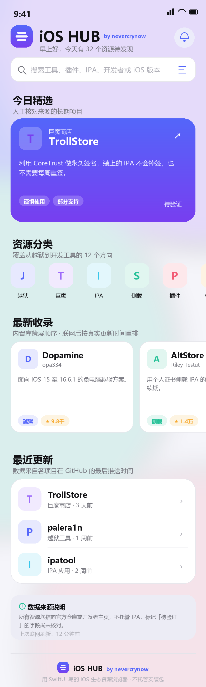
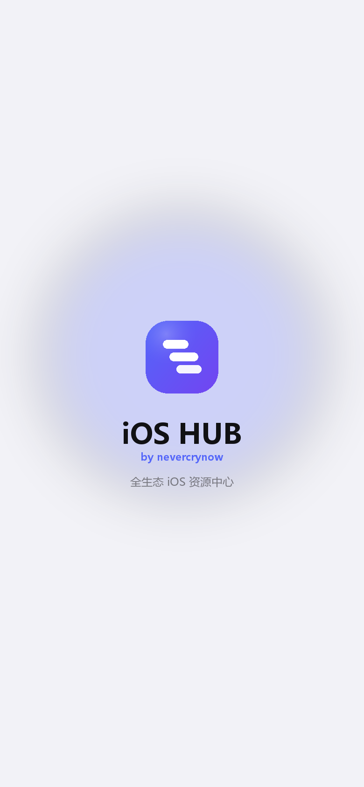

# iOS HUB · 首页 UI / UX 设计说明

设计目标：**看起来像 App Store × GitHub Mobile 的混血**，信息密度高但不拥挤，一眼能分出「这是什么 / 靠不靠谱 / 点进去能干什么」。



> 上图为按本文规范绘制的静态设计稿（`tools/render_mockup.py` 生成），不是运行截图。

---

## 0. 品牌资产（iOS HUB by nevercrynow）

| 图标 | 启动画面 |
| --- | --- |
|  |  |

- **图形**：品牌渐变（`#5466FA → #783FF0 → #9E6BFA`）圆角方块（圆角 0.30×边长）+ **阶梯状三层叠片**。叠片在单位方块内的坐标：`(0.235→0.585, y0.265)`、`(0.330→0.720, y0.437)`、`(0.425→0.765, y0.609)`，高 `0.112`、圆角 `0.056`，第三片透明度 0.94。iOS 的 `BrandLogo`（SwiftUI `Canvas`）与安卓的 `HubMark`（Compose `DrawScope`）用**同一组常量**绘制，1024 图标由 `tools/render_brand_assets.py` 按同样比例出图。
- **启动动画**（两端同节奏，总长约 1.5 秒）：光晕淡入 → 图标 0.72→1 弹簧弹入 → 三片叠片按 0.18 间隔逐条从左绘出 → `iOS HUB` 上浮淡入 → `by nevercrynow` → `全生态 iOS 资源中心` → 底部进度条 + 字距 3.4 的 `NEVERCRYNOW` → 整体放大 1.06 并淡出。节奏图见 [mockup-launch-frames.png](mockup-launch-frames.png)。
- **署名** `by nevercrynow` 只做一件事：让任何一张截图都带得走作者。它固定出现在 5 个位置 ——

| 位置 | 形式 | 字号 |
| --- | --- | --- |
| 首页品牌头 | `iOS HUB` + `by nevercrynow`（与标题基线对齐） | 27 / 10 |
| 各页顶栏右侧 | 8.5sp 淡色水印 `by nevercrynow`（无 trailing 按钮时） | 8.5 |
| 首页底部落款 | Logo + 名称 + 署名 + 一行说明 | 13 / 10 |
| 冷启动过渡页 | 居中 Logo + 名称 + 署名 + 「全生态 iOS 资源中心」 | 34 / 13 |
| 我的页品牌卡 | 渐变卡 + Logo + 名称 + 署名 + 「全生态 iOS 资源中心」 | 22 / 11 |

- 冷启动过渡页由 `LaunchBrandView` 自己计时（1.42s 后缩放淡出、0.34s 后回调 `onFinished`），系统的 LaunchScreen 仍是纯背景色，避免冷启动出现「两张图」的割裂感。
- 所有 Logo 都设了 `accessibilityHidden`，署名行用 `accessibilityElement(children: .combine)` 合并读作「iOS HUB by nevercrynow」。

---

---

## 1. 视觉基调

| 维度 | 决策 | 说明 |
| --- | --- | --- |
| 风格 | iOS 原生 + 轻量玻璃质感 | SF Symbols、连续圆角（continuous）、系统语义色 |
| 主色 | 蓝紫渐变 `#5466FA → #783FF0` | Hero、主按钮、选中态；只用一处大面积渐变 |
| 强调色 | 分类专属色（12 色） | 让「越狱/巨魔/侧载」在扫视时就被区分 |
| 背景 | `systemGroupedBackground` | 卡片浮在页面上，深色模式自动适配 |
| 卡片 | 22pt 圆角 + 1px 7% 描边 + 16pt 柔和阴影 | 不用纯色块，也不做重投影 |
| 字体 | SF Pro + `.rounded` 用于大标题/数字 | 标题 27 bold，区块标题 19 semibold，正文 15，微文案 11 semibold |
| 留白 | 页面左右 20pt，区块间距 26pt | 比 Material 松，比 Apple News 紧 |

设计 token 全部集中在 `Core/Design/Theme.swift`（`Palette` / `Metric` / `Typography`），视图里不出现魔法数字。

---

## 2. 首页信息架构（从上到下）

```
┌──────────────────────────────────────┐
│ ▣ iOS HUB by nevercrynow     🔔      │ ← 品牌头：Logo + 名称 + 作者署名 + 通知入口
│ 早上好，今天有 41 个资源待发现          │   问候语随时间段变化，带真实条目数
│ ┌──────────────────────────────────┐ │
│ │ 🔍 搜索工具、插件、IPA…     ⚙︎  │ │ ← 搜索入口（真跳转，不是假输入框）
│ └──────────────────────────────────┘ │
├──────────────────────────────────────┤
│ 今日精选                    (横滑)    │ ← 渐变大卡 300×~200
│ ┌──────────────────────────────────┐ │   分类 · 名称 · 简介 3 行
│ │ ▣ TrollStore            ↗        │ │   风险 + 兼容性胶囊
│ │ 利用 CoreTrust 做永久签名…       │ │   版本号（未核对显示「待验证」）
│ └──────────────────────────────────┘ │
├──────────────────────────────────────┤
│ 资源分类                    全部 →   │ ← 13 个圆形图标入口，单行横滑
│  ⌗越狱   ⌗巨魔   ⌗IPA   ⌗侧载  …    │   每个 46pt 图标 + 短标签
├──────────────────────────────────────┤
│ 最新收录                             │ ← 232×172 横滑卡：图标+名称+简介3行+胶囊
├──────────────────────────────────────┤
│ 最近更新                             │ ← 内嵌卡片列表（最多 4 行）
│  ▣ Dopamine   越狱工具 · 3 天前   ›  │   无数据时：说明 + 「获取最新更新时间」按钮
├──────────────────────────────────────┤
│ GitHub 热门 iOS 项目                 │ ← 仓库行：全名 / 描述 2 行 / ★ Fork 语言
│  ▣ opa334/TrollStore   ★ 22.4万 …   │   无数据时：说明 + 「从 GitHub 获取」
├──────────────────────────────────────┤
│ 最新资讯                    全部 →   │ ← 3 条，链回原文
├──────────────────────────────────────┤
│ 本周热门                             │ ← 2 列网格砖，按 Star 排
├──────────────────────────────────────┤
│ ⛨ 数据来源说明                       │ ← 灰底说明卡：不托管 IPA / 待验证含义
│   上次联网刷新：12 分钟前             │
└──────────────────────────────────────┘
```

### 每个分区的设计理由

| 分区 | 解决的问题 | 空态策略 |
| --- | --- | --- |
| 品牌头 | 建立「这是一个可信来源的目录」的第一印象：Logo + `iOS HUB` + `by nevercrynow` 署名（10pt、品牌色、与标题基线对齐），让他人搬运截图时署名不会被裁掉 | 恒显示 |
| 搜索入口 | 首页必须能在 1 次点击内进入搜索 | 恒显示 |
| 今日精选 | 让新用户 5 秒内看到「这个 App 有什么」 | 种子为空时提示文件缺失 |
| 分类入口 | 13 个方向的强导航，替代传统 Tab | 恒显示（分类是静态枚举） |
| 最新收录 | 内置库有内容可看，不依赖网络 | 恒显示 |
| 最近更新 | 展示「活的」数据 | **不编日期**，给出刷新按钮 |
| GitHub 热门 | 证明生态是实时的 | 说明需要网络 + 刷新按钮 |
| 资讯 | 版本动态 | 「不展示编造新闻」 |
| 本周热门 | 收尾的「还能看什么」 | 无 Star 时退回精选 |
| 数据说明 | 建立信任，解释「待验证」 | 恒显示 |

---

## 3. 组件规范

| 组件 | 尺寸 | 用途 |
| --- | --- | --- |
| `FeaturedCard` | 300 宽 / 自适应高 | 首页精选，唯一使用大面积渐变的位置 |
| `ResourceCard` | 232×172 | 横滑列表，固定高保证对齐 |
| `ResourceRow` | 46pt 图标 | 列表行，右侧 chevron |
| `ResourceTile` | 2 列 / 142 高 | 网格，只放名称 + 2 行简介 + 小数字 |
| `Pill` | 高 22，圆角 capsule | 标签/状态；`filled` 仅用于深色底 |
| `SectionHeader` | 19 semibold + 12 副标题 | 每个分区的标题，右侧可放「全部」 |
| `NoticeBanner` | 12 内边距，圆角 14 | 限流 / 断网 / 部分源失败，黄色系，不阻断 |

排版规则：一行内最多 2 个胶囊 + 文字，超过则换行（见 `tagRows` 每行 3 个标签的切分）。
数字缩写：≥1 万显示「1.2万」，否则千分位。

---

## 4. 交互

| 场景 | 行为 |
| --- | --- |
| 下拉刷新 | 并行刷新趋势 + 统计 + 资讯；失败只更新提示条，不清空内容 |
| 点卡片 | push 详情页（`NavigationLink(value:)` + `navigationDestination`） |
| 点搜索框 | push 搜索页并自动聚焦键盘，而不是原地展开 |
| 点通知图标 | 进入资讯列表（Phase 4 接推送后改为提醒中心） |
| 返回 | 系统手势 + 左上角返回；首页隐藏导航栏以保证沉浸 |
| 深色模式 | 全部语义色，无硬编码白底；渐变在深色下自动降饱和 |
| 无障碍 | 图标按钮都有 `accessibilityLabel`；Dynamic Type 用 `Font.system(size:)` 会随字号缩放 |

**为什么不是网站套壳**：没有 WebView；列表用 `ScrollView` + `LazyVGrid` 的原生滚动物理；push/pop 走 `NavigationStack` 转场；Tab 用系统 `TabView`；刷新用系统 `refreshable`。

---

## 5. 详情页（层级参考）

```
┌ 大图标 + 名称 + 开发者 + 分类/兼容性胶囊     ┐
│ 版本「待验证」（黄色）        风险等级（彩色）│
├ 主按钮：官方下载 / 打开 GitHub（渐变满宽）   ┤
│ 次要：GitHub | 教程 | 分享 | 收藏（四宫格）  │
├ ⚠ 风险提示（caution/high 才出现）           ┤
├ 基本信息 2×3 网格：版本/更新/支持 iOS/设备/开发者/发布 ┤
├ 项目介绍 + 标签                              ┤
├ 截图横滑（可选）                             ┤
├ 使用教程 / 更新日志（可选）                  ┤
├ 原始来源：项目主页 / GitHub / 下载 / 开发者  ┤
├ 兼容性核对状态 + 核对时间 + 脚注             ┤
```

「待验证」在详情页出现 4 次以上是有意为之：这是这类资源聚合工具最容易骗人的地方（版本号、兼容性、更新时间、来源），每处都必须能一眼看出可信度。

### 详情页的 README 区块


- 由 `MarkdownRenderer.swift` 自研解析：标题 / 段落 / 有序·无序列表 / 代码块 / 引用 / 分隔线；行内粗体、斜体、`代码`、链接交给 `AttributedString`。
- 表格与徽章图片直接跳过 —— 手机窄屏读不进去，强行渲染只会更乱。
- 超过 2 万字符截断并提示；拿不到时显示可重试的提示条，而不是空白。
- 顶部「GitHub 实时」胶囊说明这些数字是刚拉的，不是种子数据里的旧值。
